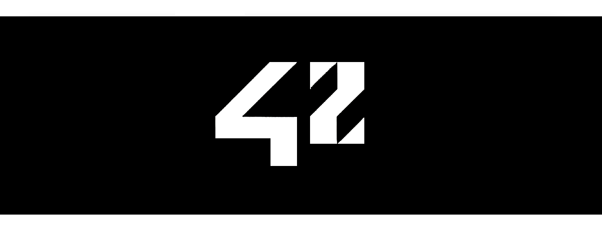

## whoami

My name is Ulisse Colla.

I'm currently working as a Mobile Developer, mainly using **Kotlin** and then also with **React Native**, and looking for a job in ***Paris***.
I discovered programming in 2021 and fell in love with it instantly.

After an introduction through a Full Stack Bootcamp (on Udemy) and a deeper dive into Web Development with another Bootcamp (with Aulab), I found what truly sparks and fuels my passion today: **low-level programming**.
This passion was born and cultivated inside the **42 school** at the Florence campus. Today, I am still a proud member of the school, and have joined the 42 Paris campus.

**C** & **C++** are my languages of choice, as you can see from the projects in my profile, but I'm open and willing to get into other languages too (Zig and Rust to name a few). I'm very curious and eager to understand how the machine works, down to every last bit, and the technologies born around it.

The most important skill I developed at the 42 school is the process of sitting down and tackling a new topic: writing code by hand (which to many might sound like a caveman thing to do nowadays), taking the wrong path, learning from my mistakes, diving into the unknown and coming back up with a little more knowledge and problem-solving skills than before. And then repeat!

I am well aware that LLMs have gotten (and keep getting) impressively good at writing code, but over time, I found that, for me, this is still the best method for developing a strong and deep grasp of the technology that I am using. The ability to build complex systems by hand and the feeling of having solved a problem myself are irreplaceable, and what made me fall in love with programming in the first place.

This being said, I also recognize that LLMs are an incredible technology and I use them regularly in my work and to study topics I want to dive into. They are here to stay and learning to use them properly and efficiently is a skill that every developer nowadays should have, without forgetting though that those who have the strongest foundations will build better software.

If I sparked your interest and you would like to have a chat, you can contact me here, on Linkedin or at ulisse.colla@protonmail.com.

Never stop learning!

